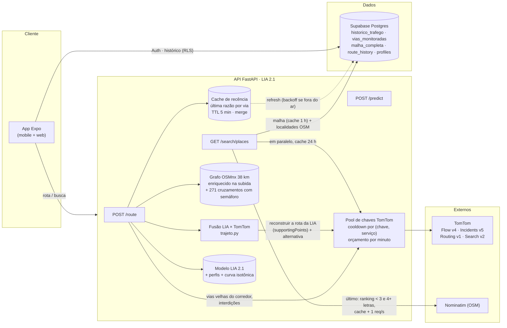

# Arquitetura — Routify

**Última revisão:** 2026-11-02

Visão de ponta a ponta do sistema na fase final do TCC 2: a coleta contínua para e a TomTom passa a ser consultada **sob demanda**, complementando a LIA (XGBoost) na hora de cada rota. Este documento atende ao item 3 do orientador: fluxo da API com o cache de recência, a rotação defensiva de chaves e o fallback da busca de endereços.

## 1. Componentes



| Componente | Arquivo | Papel |
|---|---|---|
| Grafo + enriquecimento | `apps/api/main.py`, `graph_enrichment.py` | Carrega o grafo (cache graphml), filtra vias não dirigíveis, anexa velocidade livre e o vínculo de cada aresta com a via monitorada mais próxima (BallTree, raio de 500 m). |
| Modelo LIA 2.1 | `lia_inference.py`, `ml/artifacts/` | Prevê a razão de congestionamento por via; o tempo em segundos sai do comprimento real de cada aresta. |
| Cache de recência | `recency_cache.py` | Última observação real por via (`razao_lag1`, `delta_min_lag1`). Faz merge (a leitura ao vivo vence o banco) e aplica backoff quando o Supabase cai. |
| TomTom sob demanda | `tomtom.py` | Pool de chaves, clientes HTTP, caches e as funções geométricas (corredor, interdições, incidentes na rota). |
| Knowledge Transfer | `routers/route.py` | Aresta a até 500 m de uma via monitorada herda o padrão dela, com a confiança da curva isotônica (`transfer_confidence_isotonic.pkl`). |
| Fusão LIA × TomTom + semáforos | `trajeto.py` | Snap (BallTree de nós), semáforos do OSM encaixados no cruzamento com atraso calibrado (`semaforos_calibracao.json`), tempo misto pela cobertura da LIA e regra de troca de rota. |

## 2. Fluxo do `POST /route`

```mermaid
sequenceDiagram
    autonumber
    participant App
    participant API as API /route
    participant RC as Cache de recência
    participant Pool as Pool de chaves
    participant TT as TomTom
    App->>API: origem, destino
    API->>RC: refresh se TTL venceu (backoff se o Supabase caiu)
    API->>API: snap no nó mais próximo (> 600 m = fora da malha → rota da TomTom)
    API->>API: vias monitoradas a até 1,5 km da reta O-D com recência > 10 min (máx. 8)
    par em paralelo
        API->>Pool: Flow Segment Data × vias selecionadas
        Pool->>TT: chave livre (rodízio)
        TT-->>API: velocidade atual / livre
    and
        API->>Pool: Incident Details (bbox do corredor, cache 5 min)
        Pool->>TT: chave livre
        TT-->>API: incidentes (interdição = iconCategory 8)
    end
    API->>RC: registrar razão ao vivo das vias atualizadas
    API->>API: pesos LIA em todas as arestas (recência nova já entra na feature)
    API->>API: A* (peso = LIA + atraso de semáforo; interditadas fora)
    API->>API: baseline de menor distância (instrumentação da tese)
    API->>Pool: Routing com supportingPoints = rota da LIA
    Pool->>TT: 1 chamada
    TT-->>API: ETA ao vivo da MESMA rota + alternativa se for melhor
    API->>API: tempo = cobertura·LIA + resto·TomTom; troca só com ganho ≥ 10% e ≥ 60 s
    API-->>App: polyline, tempo, fonte_rota, alternativa (tracejada), semáforos, incidentes
```

**Modo degradado.** Se não há chave configurada, todas estão em cooldown, o orçamento do minuto estourou ou a TomTom falha, o passo 5 devolve vazio: a rota sai só com a LIA (perfil histórico + última recência conhecida) e `tomtom.degradado = true`. Uma falha da TomTom nunca vira erro para o usuário.

## 3. Rotação defensiva de chaves

| Situação | Detecção | Ação |
|---|---|---|
| QPS excedido | HTTP 429, ou texto com "qps" | cooldown de 2 s só daquela chave naquele serviço; a próxima chave assume |
| Cota esgotada | 403/429 com texto de cota, ou **3 respostas 429 seguidas** na mesma chave/serviço | cooldown de 24 h (janela rolante; a cota free é mensal por API, então vira uma re-sondagem diária) |
| Chave inválida | 401/403 sem texto de cota | cooldown de 10 min |
| Erro de rede / 5xx | exceção httpx / status ≥ 500 | não penaliza a chave; a chamada falha e a rota degrada |
| Abuso | mais de `TOMTOM_MAX_CHAMADAS_MIN` chamadas/min (padrão 120) | corta as chamadas até a janela liberar |

Por que o cooldown é **por serviço**: a cota free da TomTom é mensal e separada por API (Flow 20 mil, Incidents 2,5 mil, Search 2,5 mil, Routing 20 mil por chave, segundo a página de pricing em set/2026). Esgotar Incidents numa chave não tira o Flow dela. O valor da chave nunca aparece em log, só o id.

O coletor (`services/collector/traffic_collector.py`, de volta na EC2 desde 2026-11) segue a mesma política: 429 repetido = cota (24 h), 403 = chave (10 min), round-robin a cada chamada; a cadência é dimensionada pela cota mensal com 15% de reserva pra API (`intervalo_minutos`). Os dois processos têm cooldown próprio em memória.

## 4. Busca de endereços (autocomplete)

As fontes rodam **em paralelo** e o resultado é **ranqueado numa lista só** (`ranquear()` em `apps/api/routers/search.py`), porque a nota da TomTom sai ~0,99 para tudo que contém o texto.

1. **Base local DF** (sem rede além do Supabase):
   - `malha_completa` (~38 mil vias): consulta por regex (`imatch`) em que cada vogal aceita a forma acentuada, então "helio" acha "Hélio" (o Postgres do Supabase não expõe `unaccent`). Se o PostgREST recusar o operador, volta ao `ILIKE` (sem acento) por 10 min. Cache de 1 h;
   - 602 localidades do OSM em memória (`ml/artifacts/bairros_df.json`: regiões administrativas, bairros, superquadras): "ceilandia", "asa norte", "sqs 308" saem daqui, e elas dão o bairro das vias.
2. **TomTom Search v2** — `typeahead`, `countrySet=BR`, viés para quem busca (ou o centro de Brasília; raio de 40 km), 20 resultados, cache de 24 h por consulta sem acento nem pontuação ("Park-Shopping" e "park shopping" dividem a entrada; "W3" segue colado, porque a TomTom indexa "W3 Norte"). O texto do usuário é codificado no caminho da URL (`quote(..., safe="")`).
3. **Nominatim** — último recurso: só entra se o ranking final trouxer menos de 3 resultados **e** a consulta tiver 4+ letras, com cache de 24 h e trava de 1 requisição por segundo. A política de uso da OSMF proíbe autocomplete e exige cache.

**Entendimento da consulta** (`normalizar`, `variantes`, `_casa`):
- sem acento nem pontuação, letras e números separados ("sqs308" = "sqs 308"), abreviações ("qd" = quadra);
- apelidos do DF viram uma 2ª consulta com o nome que a base usa: EPTG, EPIA e outras Estradas Parque, Eixão, UnB, Rodoviária, HBDF e hospitais regionais (tabela `APELIDOS`, conferida na malha e na TomTom);
- erro de digitação de 1 letra e palavras coladas ("shoping", "parkshoping") ainda casam, com nota menor que o casamento exato; termos de até 4 letras não ganham tolerância.

**Ranking**: nome exato > começo do nome > termos no nome > só no endereço; marco (shopping, hospital…) sobe quando o nome bate forte ou a categoria foi digitada; aglomeração só conta para quem é o nome; distância desempata homônimos (teto de 15 km). Saem: loja ou setor colado num marco, o mesmo lugar por duas fontes, a mesma via em mais de 3 trechos. Cada fonte que quebra vira lista vazia, não erro.

## 5. Dados e treino (offline)

`silver.py` puxa `historico_trafego` do Supabase para parquet → `features.py` (perfis via×hora×dia, recência) → `train.py` (XGBoost, TimeSeriesSplit de 5 folds, métricas gerais e do subconjunto congestionado) → artefatos `.pkl` (fora do git) + `*_metadata.json` (versionado). `calibrate_transfer.py` gera a curva isotônica; `benchmark_lstm_xgboost.py` e `external_validation.py` produzem as evidências da tese. `thesis_figures.py` gera as figuras do texto em `docs/figuras/`.

## 6. Pontos de falha conhecidos

- **Supabase free pausa após ~7 dias sem requisições** (aconteceu em 2026: o domínio passou a dar NXDOMAIN). Com o banco fora, o grafo sobe sem vínculo às vias e a rota cai na heurística. Mitigação: workflow de keep-alive + snapshot local de `vias_monitoradas` (pendente).
- **API sem autenticação e CORS aberto** — ver CLAUDE.md §5. O orçamento por minuto da TomTom é a única barreira contra o consumo de cota até a auth entrar.
