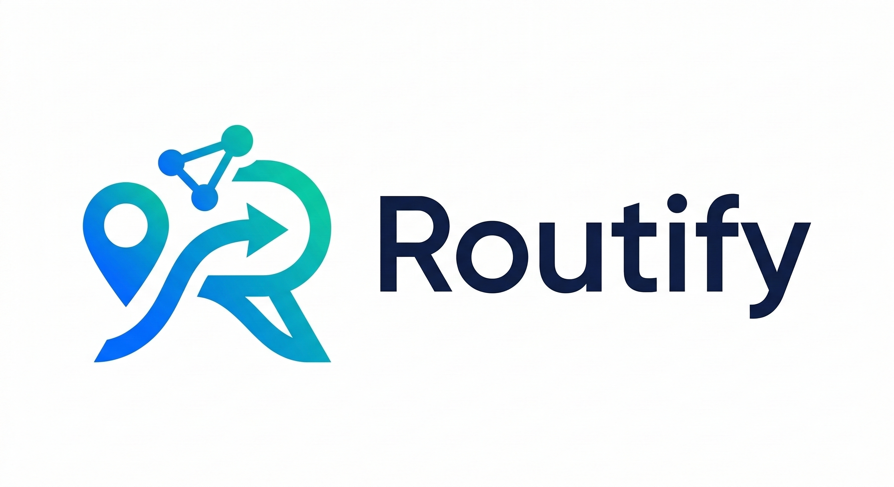

<div align="center">
  

  # Routify — Coletor de Tráfego (TomTom + OSM)
  
  
  
  
</div>

<br/>

**Última revisão:** 2026-11-02

## 📖 Sobre o Módulo
Este é o motor de dados do projeto **Routify**. Ele constrói e atualiza o *dataset* contínuo
(`historico_trafego`) que treina a LIA e alimenta a recência da API. O sistema extrai a topologia
estática das vias via OpenStreetMap (OSM) uma vez e sonda a telemetria de tráfego da TomTom
(Flow Segment Data) em ~630 pontos monitorados do DF.

Os dados ficam num Postgres hospedado no Supabase. Desde 2026-11-01 o coletor roda **na EC2 da API**
como serviço `routify-collector` (ver [`deploy/README.md`](deploy/README.md)).

## ✨ Principais Funcionalidades
* **Extração de Malha Viária:** Overpass API com rotação de servidores, só quando as tabelas estão vazias
  (o OSMnx é importado tardiamente — o host de produção nem o instala).
* **Cadência dimensionada pela cota.** A cota free da TomTom é **mensal e por API** (Flow 20 mil). O coletor
  calcula o menor intervalo que cabe no pool, com 15% reservados pra API sob demanda:
  `chaves × cota × 0,85 / 31 dias / pontos` → com 39 chaves e 630 pontos, **1 ciclo a cada 43 min**.
  `COLETOR_INTERVALO_MIN` força outro valor.
* **Rotação de chaves como na API:** round-robin a cada chamada; 429 repetido (4×) = cota esgotada,
  24 h fora; 403 sem texto de cota = chave inválida, 10 min fora; falha de rede não queima chave.
  Tudo em memória — reinício re-sonda as chaves.
* **Inserções em Lote:** um INSERT por ciclo (≈ 630 linhas).
* **Comparador LIA × provedores** (`comparar_provedores.py`): 8 rodadas por dia (timer `routify-comparador`),
  16 corredores fixos e 14 viagens entre pontos famosos (`CORREDORES_POI`, prefixo `poi-`, coordenadas do OSM em
  `pontos_df.json`). Pede a mesma viagem à LIA de produção (127.0.0.1, sem entrar na captura de uso), à TomTom
  com trânsito (referência) e ao OSRM (sem trânsito); o Mapbox entra sozinho se houver
  `MAPBOX_TOKEN` no `.env`. Grava em `comparacao_provedores` (painel `/admin/provedores`). Erro HTTP
  vira só o status: a URL da TomTom traz a chave. Em `detalhes` vão os ETAs só pelo histórico, o equivalente da LIA
  nos provedores: `historico_s` da TomTom (`computeTravelTimeFor=all`, na rota dela e no trajeto da LIA) e `tipico_s`
  do Mapbox (`duration_typical`). Até 2026-11-02 a linha `tomtom` saía sem `sem_transito_s` (faltava esse parâmetro).
* **Validação experimental (Fase 3), opcional:** `COLETOR_FASE3=1` agenda `ml/external_validation.py`
  4×/dia (7h, 12h, 18h, 22h). Carrega grafo + modelo (~1,4 GB): não cabe ao lado da API numa máquina de 2 GB.

## 🏗️ Arquitetura do Diretório
```text
📦 services/collector
 ┣ 📂 config
 ┃ ┣ 📜 .env.example             # copie para .env e preencha
 ┃ ┗ 📜 tomtom_keys.example.json # copie para tomtom_keys.json e preencha
 ┣ 📂 deploy                   # EC2: instalador, unidade systemd, requirements mínimos
 ┣ 📂 tests                    # rotação, classificação de 429/403, cadência (sem rede, sem banco)
 ┣ 📜 db.py                    # Conexão e queries em lote para o Supabase
 ┣ 📜 map_extractor.py         # Extração OpenStreetMap (Overpass) — só no bootstrap
 ┣ 📜 traffic_collector.py     # Consumo da API TomTom (rotação de chaves, intervalo_minutos)
 ┣ 📜 comparar_provedores.py   # LIA × TomTom × OSRM nos mesmos corredores (timer na EC2)
 ┣ 📜 main.py                  # Orquestrador: coleta (cadência pela cota) + Fase 3 opt-in
 ┗ 📜 requirements.txt         # dev local (inclui OSMnx pro bootstrap)
```

## 🚀 Como iniciar o coletor
### 1. Pré-requisitos
- Python 3.10 ou superior.
- Supabase com as tabelas `malha_completa`, `vias_monitoradas`, `historico_trafego` (RLS ligado e sem policy:
  só a chave `service_role` escreve).
- Chaves de desenvolvedor da TomTom.

### 2. Instalação e Configuração
```bash
cd services/collector
pip install -r requirements.txt
cp config/.env.example config/.env                      # SUPABASE_URL + SUPABASE_KEY (service_role)
cp config/tomtom_keys.example.json config/tomtom_keys.json
```
`tomtom_keys.json` segue `{ "tomtom_keys": [ { "id": "key_01", "key": "..." }, ... ] }`. A API e o `ml/`
leem esses mesmos dois arquivos.

### 3. Executando
```bash
python main.py                       # cadência calculada pela cota (log mostra "Cadência: 1 ciclo a cada N min")
COLETOR_INTERVALO_MIN=8 python main.py   # forçar 8 min (ex.: teste curto com poucas chaves)
COLETOR_FASE3=1 python main.py       # também agenda a Fase 3 (precisa de ml/ e apps/api/ no mesmo clone)
python comparar_provedores.py --sem-gravar   # uma rodada do comparador, só no log (API em ROUTIFY_API_INTERNA)
python -m pytest -q tests            # testes (rede e banco simulados)
```
Encerrar com `Ctrl + C`.

| Variável | Efeito | Padrão |
|---|---|---|
| `COLETOR_INTERVALO_MIN` | força a cadência | calculado |
| `COLETOR_COTA_MENSAL_CHAVE` | cota mensal de Flow por chave | `20000` |
| `COLETOR_RESERVA_API` | fatia do pool reservada pra API | `0.15` |
| `COLETOR_FASE3` | `1` liga a Fase 3 | `0` |
| `TOMTOM_KEYS_FILE` | outro arquivo de chaves (subconjunto do pool) | `config/tomtom_keys.json` |
| `ROUTIFY_API_INTERNA` | API que o comparador consulta | `http://127.0.0.1:8000` |
| `MAPBOX_TOKEN` | liga o Mapbox (trânsito ao vivo) no comparador | ausente |

## 🚨 Troubleshooting

| Erro | Causa | Solução |
|---|---|---|
| `supabase.exceptions.AuthApiError: Invalid API key` | Key/URL erradas em `.env` | Conferir `config/.env` — chave `service_role` completa, URL com `https://` |
| Inserts falham com `42501` / RLS | `.env` com a chave pública (anon) | As tabelas do dataset negam a anon; usar a `service_role` |
| `KeyError: 'tomtom_keys'` | Estrutura do JSON errada | `{ "tomtom_keys": [...] }` |
| `Cota da chave [...] esgotada` em várias chaves | Pool consumido no mês (API + coletor) | Esperar o reset mensal; conferir `intervalo_minutos`; separar o pool com `TOMTOM_KEYS_FILE` |
| `Todas as chaves em cooldown` logo ao subir | Chaves inválidas (403) ou sem rede | Testar 1 chamada por chave; o cooldown de 403 é de 10 min |
| Coletor trava no bootstrap | Overpass offline ou lento | Só acontece com tabelas vazias; `map_extractor.py` rotaciona servidores |
| Memória alta | Fase 3 ligada | `COLETOR_FASE3=0` numa máquina de 2 GB |

## 🔍 Logs Esperados

```
INFO - Conexão com Supabase estabelecida com sucesso (630 vias monitoradas).
INFO - As tabelas da malha já estão populadas no Supabase.
INFO - Cadência: 1 ciclo a cada 43 min — 39 chaves × 20000/mês, 630 pontos, reserva de 15% pra API
INFO - Fase 3 desligada (COLETOR_FASE3=1 para ligar).
INFO - Monitorando ponto ID 1 (Eixo Rodoviário Sul)...
...
INFO - Salvando lote de 630 registros capturados no banco...
```

<div align="center">
  

 <i>Desenvolvido para o avanço em Cidades Inteligentes e Logística Preditiva.</i>
</div>
